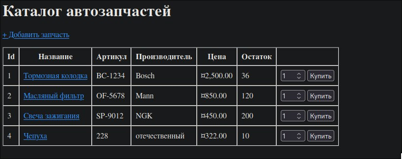
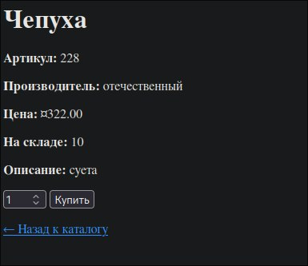
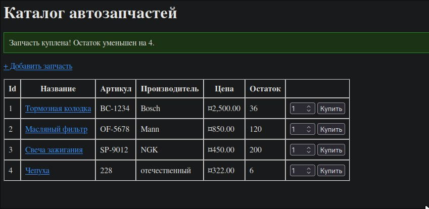

# Практическая работа. ADO.NET: класс DbHelper для работы с PostgreSQL

Реализация класса доступа к данным `DbHelper` через ADO.NET (Npgsql) в веб-приложении ASP.NET Core MVC, запущенном в Docker вместе с базой PostgreSQL.

---

## Задание. Реализовать DbHelper для приложения «Автозапчасти»

### Что требовалось
Развернуть рабочую среду (.NET 8, Docker, PostgreSQL) и реализовать пять методов класса `DbHelper` через `NpgsqlConnection`, `NpgsqlCommand` и `NpgsqlDataReader`: инициализацию таблицы, чтение списка, чтение одной записи, добавление и уменьшение остатка при покупке.

### Что сделано
Проект `AutoPartsApp` (ASP.NET Core MVC, .NET 8) запускается через `docker compose` из двух контейнеров: `db` (PostgreSQL 16) и `web` (приложение). Строка подключения передаётся в приложение переменной окружения `ConnectionStrings__Default`, внутри docker-сети хост базы — `db`.

#### Метод 1. Initialize()

Создаёт таблицу `parts`, если её нет, и заполняет тестовыми данными, если таблица пуста. Вызывается один раз при старте приложения.

```csharp
using var connection = new NpgsqlConnection(_connectionString);
connection.Open();

using (var createCmd = new NpgsqlCommand(@"
    CREATE TABLE IF NOT EXISTS parts (
        id           SERIAL PRIMARY KEY,
        name         VARCHAR(200) NOT NULL,
        article      VARCHAR(50)  NOT NULL,
        manufacturer VARCHAR(100) NOT NULL,
        price        NUMERIC(18,2) NOT NULL,
        stock        INTEGER NOT NULL DEFAULT 0,
        description  VARCHAR(500)
    )", connection))
{
    createCmd.ExecuteNonQuery();
}

using var checkCmd = new NpgsqlCommand("SELECT COUNT(*) FROM parts", connection);
var count = Convert.ToInt32(checkCmd.ExecuteScalar());

if (count == 0)
{
    using var seedCmd = new NpgsqlCommand(@"
        INSERT INTO parts (name, article, manufacturer, price, stock, description) VALUES
        ('Тормозная колодка', 'BC-1234', 'Bosch', 2500.00, 40, 'Передняя, для легковых авто'),
        ('Масляный фильтр', 'OF-5678', 'Mann', 850.00, 120, 'Универсальный'),
        ('Свеча зажигания', 'SP-9012', 'NGK', 450.00, 200, 'Иридиевая')", connection);
    seedCmd.ExecuteNonQuery();
}
```

#### Метод 2. GetAllParts() и вспомогательный ReadPart()

Читает все запчасти через `NpgsqlDataReader`. Преобразование строки в объект вынесено в `ReadPart`, чтобы не дублировать код.

```csharp
public List<Part> GetAllParts()
{
    var parts = new List<Part>();

    using var connection = new NpgsqlConnection(_connectionString);
    connection.Open();

    using var cmd = new NpgsqlCommand(
        "SELECT id, name, article, manufacturer, price, stock, description FROM parts ORDER BY id",
        connection);
    using var reader = cmd.ExecuteReader();

    while (reader.Read())
    {
        parts.Add(ReadPart(reader));
    }

    return parts;
}

private static Part ReadPart(NpgsqlDataReader reader)
{
    return new Part
    {
        Id = reader.GetInt32(0),
        Name = reader.GetString(1),
        Article = reader.GetString(2),
        Manufacturer = reader.GetString(3),
        Price = reader.GetDecimal(4),
        Stock = reader.GetInt32(5),
        Description = reader.IsDBNull(6) ? null : reader.GetString(6)
    };
}
```

#### Метод 3. GetPartById()

Возвращает одну запчасть по `id` или `null`, если не найдена. Значение передаётся параметром.

```csharp
public Part? GetPartById(int id)
{
    using var connection = new NpgsqlConnection(_connectionString);
    connection.Open();

    using var cmd = new NpgsqlCommand(
        "SELECT id, name, article, manufacturer, price, stock, description FROM parts WHERE id = @id",
        connection);
    cmd.Parameters.AddWithValue("@id", id);

    using var reader = cmd.ExecuteReader();
    if (reader.Read())
    {
        return ReadPart(reader);
    }

    return null;
}
```

#### Метод 4. AddPart()

Добавляет запчасть. Необязательное описание при отсутствии значения передаётся как `DBNull.Value`.

```csharp
public void AddPart(Part part)
{
    using var connection = new NpgsqlConnection(_connectionString);
    connection.Open();

    using var cmd = new NpgsqlCommand(@"
        INSERT INTO parts (name, article, manufacturer, price, stock, description)
        VALUES (@name, @article, @manufacturer, @price, @stock, @description)", connection);
    cmd.Parameters.AddWithValue("@name", part.Name);
    cmd.Parameters.AddWithValue("@article", part.Article);
    cmd.Parameters.AddWithValue("@manufacturer", part.Manufacturer);
    cmd.Parameters.AddWithValue("@price", part.Price);
    cmd.Parameters.AddWithValue("@stock", part.Stock);
    cmd.Parameters.AddWithValue("@description", (object?)part.Description ?? DBNull.Value);

    cmd.ExecuteNonQuery();
}
```

#### Метод 5. DecreaseStock()

Атомарно уменьшает остаток при покупке. Проверка остатка выполняется в самом запросе.

```csharp
public bool DecreaseStock(int partId, int quantity)
{
    using var connection = new NpgsqlConnection(_connectionString);
    connection.Open();

    using var cmd = new NpgsqlCommand(@"
        UPDATE parts
        SET stock = stock - @qty
        WHERE id = @id AND stock >= @qty", connection);
    cmd.Parameters.AddWithValue("@id", partId);
    cmd.Parameters.AddWithValue("@qty", quantity);

    return cmd.ExecuteNonQuery() > 0;
}
```

#### Запуск и проверка

```bash
docker compose up -d --build web
docker compose ps
docker compose logs --tail=20 web
docker compose exec db psql -U partsuser -d autopartsdb -c "SELECT * FROM parts;"
```

### Результат

Приложение доступно на `http://localhost:8080`. После первого запуска в таблице `parts` три записи:

| Id | Название | Артикул | Производитель | Цена | Остаток |
|---|---|---|---|---|---|
| 1 | Тормозная колодка | BC-1234 | Bosch | 2500.00 | 40 |
| 2 | Масляный фильтр | OF-5678 | Mann | 850.00 | 120 |
| 3 | Свеча зажигания | SP-9012 | NGK | 450.00 | 200 |


Добавление запчасти через форму и покупка уменьшают остаток. Данные сохраняются после перезапуска контейнеров благодаря Docker-тому (volume) `pgdata`.


Попытка купить больше, чем есть на складе, не меняет остаток и выводит сообщение о нехватке товара.


### Анализ
- Каждый метод открывает соединение через `NpgsqlConnection`, выполняет `NpgsqlCommand` и закрывает соединение автоматически благодаря `using`.
- `ExecuteNonQuery()` используется для `CREATE`, `INSERT` и `UPDATE`, `ExecuteScalar()` для `SELECT COUNT(*)`, `ExecuteReader()` для выборки строк.
- Все значения передаются параметрами (`@id`, `@name` и т. д.), а не склеиваются в строку SQL, поэтому SQL-инъекции невозможны.
- `CREATE TABLE IF NOT EXISTS` и вставка тестовых данных только при пустой таблице делают инициализацию безопасной при повторных запусках.
- `DecreaseStock` проверяет остаток условием `stock >= @qty` в самом `UPDATE`: при нехватке товара ни одна строка не обновляется, метод возвращает `false`, остаток не уходит в минус даже при одновременных покупках.
- Порядок колонок в `SELECT` должен совпадать с индексами в `ReadPart`, а для необязательной колонки `description` нужна проверка `IsDBNull`.

### Вывод
Реализованы пять методов `DbHelper` с использованием ADO.NET и Npgsql. Приложение вместе с PostgreSQL запускается одной командой `docker compose up`, чтение, добавление и покупка работают, данные сохраняются между перезапусками.

---

## Стек

.NET 8, ASP.NET Core MVC, Npgsql 8.0.5, PostgreSQL 16, Docker Compose, Arch Linux, Code - OSS.

---

## Скриншоты

### 1. Добавление лота

Форма добавления новой запчасти с заполненными полями.



### 2. Лот добавлен

Список запчастей, в котором появилась новая запись.


### 3. Информация о лоте

Страница с подробной информацией о запчасти.



### 4. Покупка лота

Покупка запчасти: остаток уменьшился, показано сообщение об успешной покупке.


